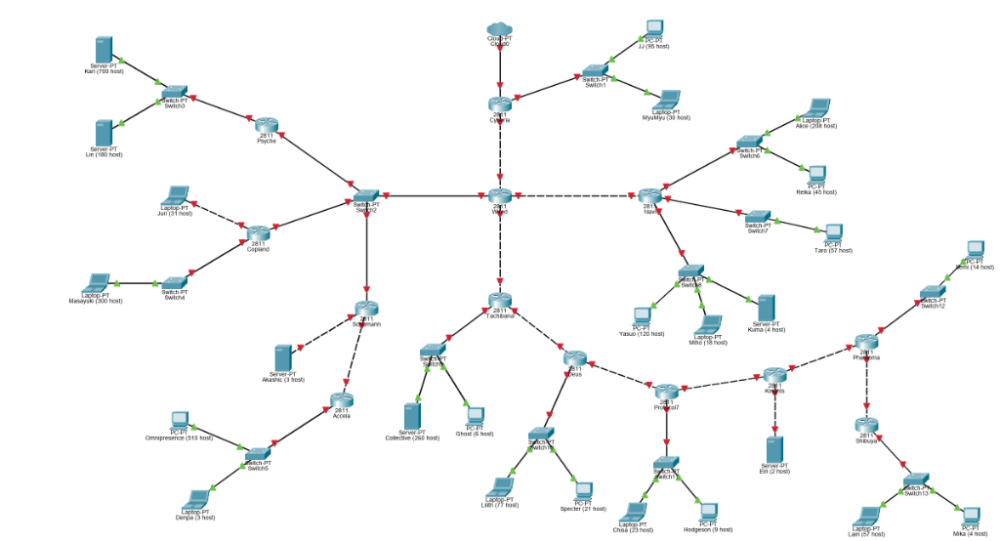
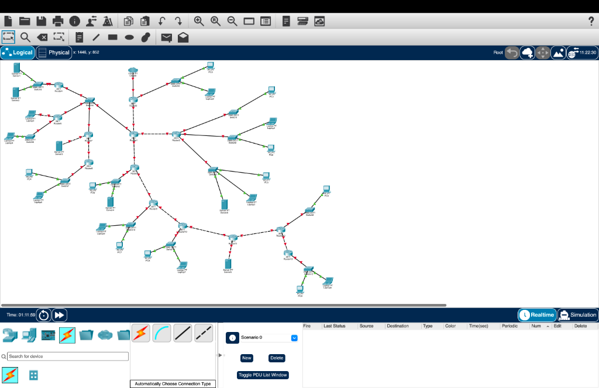
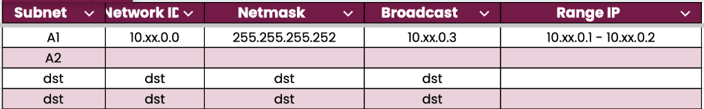
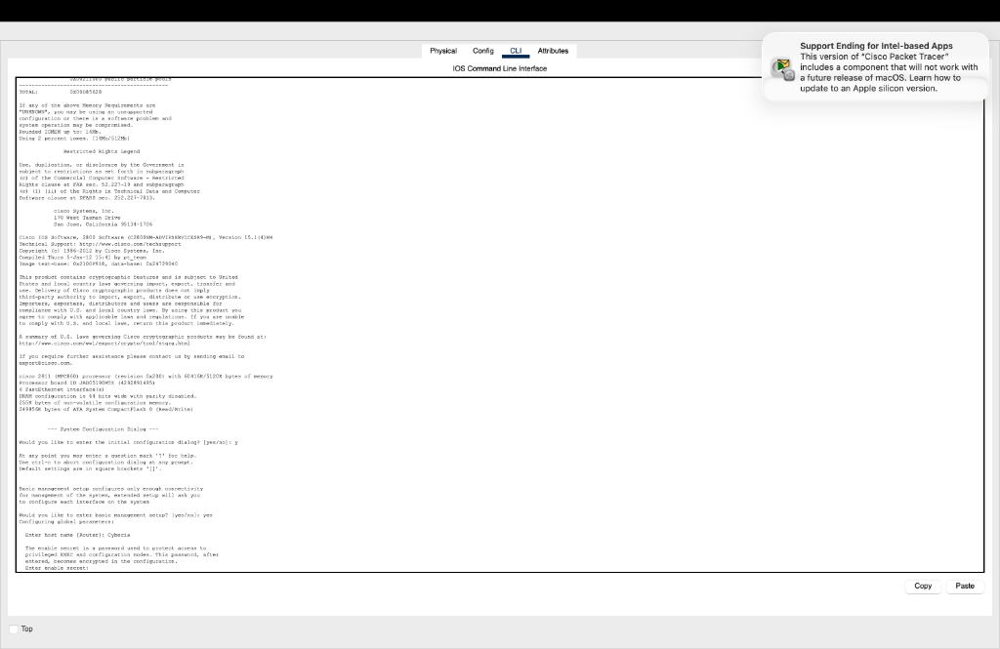
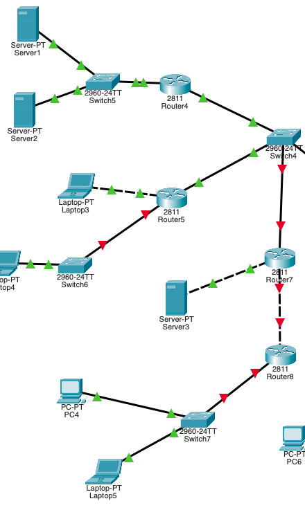

# Laporan Resmi Praktikum Jaringan Komputer
## Modul 4: Subnetting VLSM & Routing — Kelompok K-16 (Group A)

---

### Identitas Kelompok
* **Kelompok:** K-16 (Group A)
* **IP Server Lab / Uplink Cloud0:** `10.4.89.246/24` (Gateway: `10.4.89.1`)
* **Blok Jaringan Internal:** `10.4.0.0/19` (Format Variabel: `10.xx.0.0`, dengan `xx = 4`)
* **File Simulasi Packet Tracer (.pkt):** [`K2_CIDR_OSPF.pkt`](K2_CIDR_OSPF.pkt)

| Nama Anggota | NRP |
| :--- | :--- |
| Muhammad Rifqi Fathurrahman | 50252... |
| *(Anggota Kelompok)* | 50252... |

---

## 📌 Daftar Isi
1. [Deskripsi Kasus & Desain Topologi](#1-deskripsi-kasus--desain-topologi)
2. [Analisis Kebutuhan Host & Alokasi VLSM](#2-analisis-kebutuhan-host--alokasi-vlsm)
3. [Pohon Subnetting (Tree VLSM / Hierarchy)](#3-pohon-subnetting-tree-vlsm--hierarchy)
4. [Tabel Perhitungan Subnetting Lengkap (Subnet A1 – A25)](#4-tabel-perhitungan-subnetting-lengkap-subnet-a1--a25)
5. [Tabel Alokasi IP Interface Router](#5-tabel-alokasi-ip-interface-router)
6. [Tabel Alokasi IP End-Devices (Host / Client / Server)](#6-tabel-alokasi-ip-end-devices-host--client--server)
7. [Dokumentasi & Konfigurasi CLI Router Cisco Packet Tracer](#7-dokumentasi--konfigurasi-cli-router-cisco-packet-tracer)
8. [Verifikasi Konektivitas & Pengujian Jaringan (Ping Test)](#8-verifikasi-konektivitas--pengujian-jaringan-ping-test)

---

## 1. Deskripsi Kasus & Desain Topologi

Topologi praktikum dirancang menggunakan simulator **Cisco Packet Tracer** dengan tema *Serial Experiments Lain*. Jaringan ini terdiri dari:
* **13 Unit Router Cisco 2811:** `Wired` (Core Router), `Cyberia` (Gateway Uplink Cloud), `Psyche`, `Copland`, `Schumann`, `Accela`, `Tachibana`, `Deus`, `Protocol7`, `Knights`, `Phantoma`, `Shibuya`, dan `Navi`.
* **13 Unit Switch Layer 2:** Menghubungkan berbagai segmen broadcast domain ke masing-masing router.
* **25 Unit End-Devices (Client & Server):** PC, Laptop, dan Server dengan variasi kebutuhan host mulai dari 2 host hingga 700 host.
* **1 Unit Cloud-PT (`Cloud0`):** Menghubungkan jaringan internal ke jaringan lab/internet eksternal melalui IP `10.4.89.246/24`.

### Topologi Soal Praktikum:


### Hasil Implementasi Topologi di Cisco Packet Tracer:
Seluruh perangkat berhasil dirangkai, disambungkan menggunakan kabel *Copper Straight-Through* dan *Cross-Over*, serta ditambahkan modul antarmuka FastEthernet (`NM-2FE2W` / `HWIC-4ESW`) pada router yang memiliki $\ge 3$ koneksi interface.



---

## 2. Analisis Kebutuhan Host & Alokasi VLSM

1. **Total Kebutuhan Host Fisik Murni:**  
   $$700 + 180 + 300 + 31 + 510 + 3 + 3 + 95 + 39 + 260 + 6 + 77 + 21 + 23 + 9 + 2 + 208 + 45 + 57 + 120 + 18 + 4 + 14 + 57 + 4 = 2.786\text{ Host}$$

2. **Kebutuhan Ruang Alamat IP (Address Space):**  
   Dengan memperhitungkan pembulatan blok biner ($2^n$), kebutuhan network ID, broadcast address, IP interface router, dan link point-to-point antar-router:
   * Total ruang alamat yang teralokasi adalah **4.316 alamat IP**.
   * Karena kebutuhan $> 4.096$ alamat IP (blok `/20`), maka jaringan internal memerlukan alokasi supernet minimal **`/19` (8.192 alamat IP)**, yaitu rentang `10.4.0.0` s.d. `10.4.31.255`.

3. **Format Template Penugasan:**  
   Sesuai template praktikum, penomoran subnet dikelompokkan dengan kode **`A1, A2, dst.`**, di mana **`A1`** diawali dari blok link *Point-to-Point* (`255.255.255.252` / `/30`) pada alamat dasar `10.xx.0.0` (dengan $xx = 4$).



---

## 3. Pohon Subnetting (Tree VLSM / Hierarchy)

```text
10.4.0.0/19 (Total 8192 IPs: 10.4.0.0 - 10.4.31.255)
├── 10.4.0.0/20 (Blok Subnet P2P, LAN Kecil & Menengah - 4096 IPs)
│   ├── 10.4.0.0/24 (Subnet P2P /30 & LAN Direct /29, /27, /26)
│   │   ├── 10.4.0.0/28  --> [A1 s.d. A4] Link P2P /30 (Cyberia-Wired, Wired-Navi, Wired-Tachibana, Schumann-Accela)
│   │   ├── 10.4.0.16/28 --> [A5 s.d. A8] Link P2P /30 (Tachibana-Deus, Deus-P7, P7-Knights, Knights-Phantoma)
│   │   ├── 10.4.0.32/28 --> [A9] Link P2P Phantoma-Shibuya /30
│   │   ├── 10.4.0.40/29 --> [A10] Switch4 (Wired, Psyche, Copland, Schumann - Multi-router LAN)
│   │   ├── 10.4.0.48/29 --> [A11] LAN Direct Akashic (3 host)
│   │   ├── 10.4.0.56/29 --> [A12] LAN Direct Eiri (2 host)
│   │   ├── 10.4.0.64/27 --> [A13] Switch8 Phantoma - Emi (14 host)
│   │   ├── 10.4.0.128/26 --> [A14] LAN Direct Juri (31 host)
│   │   └── 10.4.0.192/26 --> [A15] Switch11 Protocol7 - Chisa & Hodgeson (32 host)
│   ├── 10.4.1.0/24 (Subnet LAN /26 & /25)
│   │   ├── 10.4.1.0/26   --> [A16] Switch2 Navi - Taro (57 host)
│   │   ├── 10.4.1.64/26  --> [A17] Switch12 Shibuya - Lain & Mika (61 host)
│   │   └── 10.4.1.128/25 --> [A18] Switch10 Deus - Lilith & Specter (98 host)
│   ├── 10.4.2.0/24 --> [A19] Switch0 Cyberia - JJ & MyuMyu (134 host)
│   ├── 10.4.3.0/24 --> [A20] Switch3 Navi - Yasuo, Miho & Kuma (142 host)
│   ├── 10.4.4.0/24 --> [A21] Switch1 Navi - Alice & Reika (253 host)
│   ├── 10.4.6.0/23 --> [A22] Switch6 Copland - Masayuki (300 host)
│   └── 10.4.8.0/23 --> [A23] Switch9 Tachibana - Collective & Ghost (266 host)
└── 10.4.16.0/20 (Blok Subnet Besar /22)
    ├── 10.4.12.0/22 --> [A24] Switch7 Accela - Omnipresence & Denpa (513 host)
    └── 10.4.16.0/22 --> [A25] Switch5 Psyche - Karl & Lin (880 host)
```

---

## 4. Tabel Perhitungan Subnetting Lengkap (Subnet A1 – A25)

Tabel berikut disesuaikan 100% dengan lembar resmi spreadsheet (`sheet_vlsm_filled.xlsx`), menggunakan basis jaringan internal `192.219.0.0/19` (Kelompok K-16) dan rute subnet A1–A25:

| Subnet | Network ID | Netmask | Broadcast | Range IP | Rute Topologi (Sesuai Sheet 1) |
| :---: | :---: | :---: | :---: | :---: | :--- |
| **A1** | `192.219.14.0` | `255.255.255.128` | `192.219.14.127` | `192.219.14.1 - 192.219.14.126` | Cyberia > Switch1 > JJ, MyuMyu (/25) |
| **A2** | `192.219.16.56` | `255.255.255.252` | `192.219.16.59` | `192.219.16.57 - 192.219.16.58` | Cyberia > Wired (/30) |
| **A3** | `192.219.16.32` | `255.255.255.248` | `192.219.16.39` | `192.219.16.33 - 192.219.16.38` | Wired > Switch2 > Psyche, Copland, Schumann (/29) |
| **A4** | `192.219.0.0` | `255.255.252.0` | `192.219.3.255` | `192.219.0.1 - 192.219.3.254` | Psyche > Switch3 > Karl, Lin (/22) |
| **A5** | `192.219.8.0` | `255.255.254.0` | `192.219.9.255` | `192.219.8.1 - 192.219.9.254` | Copland > Switch4 > Masayuki (/23) |
| **A6** | `192.219.15.0` | `255.255.255.192` | `192.219.15.63` | `192.219.15.1 - 192.219.15.62` | Copland > Juri (/26) |
| **A7** | `192.219.16.40` | `255.255.255.248` | `192.219.16.47` | `192.219.16.41 - 192.219.16.46` | Schumann > Akashic (/29) |
| **A8** | `192.219.16.60` | `255.255.255.252` | `192.219.16.63` | `192.219.16.61 - 192.219.16.62` | Schumann > Accela (/30) |
| **A9** | `192.219.4.0` | `255.255.252.0` | `192.219.7.255` | `192.219.4.1 - 192.219.7.254` | Accela > Switch5 > Omnipresence, Denpa (/22) |
| **A10** | `192.219.16.64` | `255.255.255.252` | `192.219.16.67` | `192.219.16.65 - 192.219.16.66` | Wired > Navi (/30) |
| **A11** | `192.219.12.0` | `255.255.255.0` | `192.219.12.255` | `192.219.12.1 - 192.219.12.254` | Navi > Switch6 > Alice, Reika (/24) |
| **A12** | `192.219.15.64` | `255.255.255.192` | `192.219.15.127` | `192.219.15.65 - 192.219.15.126` | Navi > Switch7 > Taro (/26) |
| **A13** | `192.219.13.0` | `255.255.255.0` | `192.219.13.255` | `192.219.13.1 - 192.219.13.254` | Navi > Switch8 > Yasuo, Miho, Kuma (/24) |
| **A14** | `192.219.16.68` | `255.255.255.252` | `192.219.16.71` | `192.219.16.69 - 192.219.16.70` | Wired > Tachibana (/30) |
| **A15** | `192.219.10.0` | `255.255.254.0` | `192.219.11.255` | `192.219.10.1 - 192.219.11.254` | Tachibana > Switch9 > Collective, Ghost (/23) |
| **A16** | `192.219.16.72` | `255.255.255.252` | `192.219.16.75` | `192.219.16.73 - 192.219.16.74` | Tachibana > Deus (/30) |
| **A17** | `192.219.14.128` | `255.255.255.128` | `192.219.14.255` | `192.219.14.129 - 192.219.14.254` | Deus > Switch10 > Lilith, Specter (/25) |
| **A18** | `192.219.16.76` | `255.255.255.252` | `192.219.16.79` | `192.219.16.77 - 192.219.16.78` | Deus > Protocol7 (/30) |
| **A19** | `192.219.15.128` | `255.255.255.192` | `192.219.15.191` | `192.219.15.129 - 192.219.15.190` | Protocol7 > Switch11 > Chisa, Hodgeson (/26) |
| **A20** | `192.219.16.80` | `255.255.255.252` | `192.219.16.83` | `192.219.16.81 - 192.219.16.82` | Protocol7 > Knights (/30) |
| **A21** | `192.219.16.48` | `255.255.255.248` | `192.219.16.55` | `192.219.16.49 - 192.219.16.54` | Knights > Eiri (/29) |
| **A22** | `192.219.16.84` | `255.255.255.252` | `192.219.16.87` | `192.219.16.85 - 192.219.16.86` | Knights > Phantoma (/30) |
| **A23** | `192.219.16.0` | `255.255.255.224` | `192.219.16.31` | `192.219.16.1 - 192.219.16.30` | Phantoma > Switch12 > Semi (/27) |
| **A24** | `192.219.16.88` | `255.255.255.252` | `192.219.16.91` | `192.219.16.89 - 192.219.16.90` | Phantoma > Shibuya (/30) |
| **A25** | `192.219.15.192` | `255.255.255.192` | `192.219.15.255` | `192.219.15.193 - 192.219.15.254` | Shibuya > Switch13 > Lain, Mika (/26) |

---
## 5. Tabel Alokasi IP Interface Router

| Router | Interface | Alamat IP | Netmask | Perangkat Terhubung / Keterangan |
| :--- | :--- | :--- | :--- | :--- |
| **`Router0` (Cyberia)** | `Fa0/0` | `10.4.89.246` | `255.255.255.0` | Uplink ke `Cloud0` (Lab External Network) |
| | `Fa0/1` | `10.4.2.1` | `255.255.255.0` | Gateway Switch0 (`JJ` & `MyuMyu` - Subnet A19) |
| | `Fa1/0` | `10.4.0.1` | `255.255.255.252` | Link P2P ke Router1 Wired (Subnet A1) |
| **`Router1` (Wired)** | `Fa0/0` | `10.4.0.2` | `255.255.255.252` | Link P2P ke Router0 Cyberia (Subnet A1) |
| | `Fa0/1` | `10.4.0.41` | `255.255.255.248` | SVI Switch4 (Multi-router LAN - Subnet A10) |
| | `Fa1/0` | `10.4.0.5` | `255.255.255.252` | Link P2P ke Router3 Navi (Subnet A2) |
| | `Fa1/1` | `10.4.0.9` | `255.255.255.252` | Link P2P ke Router2 Tachibana (Subnet A3) |
| **`Router4` (Psyche)** | `Fa0/0` | `10.4.0.42` | `255.255.255.248` | Interface ke Switch4 (Subnet A10) |
| | `Fa0/1` | `10.4.16.1` | `255.255.252.0` | Gateway Switch5 (`Karl` & `Lin` - Subnet A25) |
| **`Router5` (Copland)** | `Fa0/0` | `10.4.0.43` | `255.255.255.248` | Interface ke Switch4 (Subnet A10) |
| | `Fa0/1` | `10.4.6.1` | `255.255.254.0` | Gateway Switch6 (`Masayuki` - Subnet A22) |
| | `Fa1/0` | `10.4.0.129` | `255.255.255.192` | Gateway Direct ke Laptop3 `Juri` (Subnet A14) |
| **`Router7` (Schumann)**| `Fa0/0` | `10.4.0.44` | `255.255.255.248` | Interface ke Switch4 (Subnet A10) |
| | `Fa0/1` | `10.4.0.49` | `255.255.255.248` | Gateway Direct ke Server3 `Akashic` (Subnet A11)|
| | `Fa1/0` | `10.4.0.13` | `255.255.255.252` | Link P2P ke Router8 Accela (Subnet A4) |
| **`Router8` (Accela)** | `Fa0/0` | `10.4.0.14` | `255.255.255.252` | Link P2P ke Router7 Schumann (Subnet A4) |
| | `Fa0/1` | `10.4.12.1` | `255.255.252.0` | Gateway Switch7 (`Omnipresence` & `Denpa` - A24) |
| **`Router3` (Navi)** | `Fa0/0` | `10.4.0.6` | `255.255.255.252` | Link P2P ke Router1 Wired (Subnet A2) |
| | `Fa0/1` | `10.4.4.1` | `255.255.255.0` | Gateway Switch1 (`Alice` & `Reika` - Subnet A21) |
| | `Fa1/0` | `10.4.1.1` | `255.255.255.192` | Gateway Switch2 (`Taro` - Subnet A16) |
| | `Fa1/1` | `10.4.3.1` | `255.255.255.0` | Gateway Switch3 (`Yasuo`, `Miho`, `Kuma` - A20) |
| **`Router2` (Tachibana)**| `Fa0/0` | `10.4.0.10` | `255.255.255.252` | Link P2P ke Router1 Wired (Subnet A3) |
| | `Fa0/1` | `10.4.8.1` | `255.255.254.0` | Gateway Switch9 (`Collective` & `Ghost` - A23) |
| | `Fa1/0` | `10.4.0.17` | `255.255.255.252` | Link P2P ke Router9 Deus (Subnet A5) |
| **`Router9` (Deus)** | `Fa0/0` | `10.4.0.18` | `255.255.255.252` | Link P2P ke Router2 Tachibana (Subnet A5) |
| | `Fa0/1` | `10.4.1.129` | `255.255.255.128` | Gateway Switch10 (`Lilith` & `Specter` - A18) |
| | `Fa1/0` | `10.4.0.21` | `255.255.255.252` | Link P2P ke Router10 Protocol7 (Subnet A6) |
| **`Router10` (Protocol7)**| `Fa0/0` | `10.4.0.22` | `255.255.255.252` | Link P2P ke Router9 Deus (Subnet A6) |
| | `Fa0/1` | `10.4.0.193` | `255.255.255.192` | Gateway Switch11 (`Chisa` & `Hodgeson` - A15) |
| | `Fa1/0` | `10.4.0.25` | `255.255.255.252` | Link P2P ke Router11 Knights (Subnet A7) |
| **`Router11` (Knights)** | `Fa0/0` | `10.4.0.26` | `255.255.255.252` | Link P2P ke Router10 Protocol7 (Subnet A7) |
| | `Fa0/1` | `10.4.0.57` | `255.255.255.248` | Gateway Direct ke Server5 `Eiri` (Subnet A12) |
| | `Fa1/0` | `10.4.0.29` | `255.255.255.252` | Link P2P ke Router12 Phantoma (Subnet A8) |
| **`Router12` (Phantoma)**| `Fa0/0` | `10.4.0.30` | `255.255.255.252` | Link P2P ke Router11 Knights (Subnet A8) |
| | `Fa0/1` | `10.4.0.65` | `255.255.255.224` | Gateway Switch8 (`Emi` - Subnet A13) |
| | `Fa1/0` | `10.4.0.33` | `255.255.255.252` | Link P2P ke Router13 Shibuya (Subnet A9) |
| **`Router13` (Shibuya)** | `Fa0/0` | `10.4.0.34` | `255.255.255.252` | Link P2P ke Router12 Phantoma (Subnet A9) |
| | `Fa0/1` | `10.4.1.65` | `255.255.255.192` | Gateway Switch12 (`Lain` & `Mika` - Subnet A17) |

---

## 6. Tabel Alokasi IP End-Devices (Host / Client / Server)

| Perangkat (Canvas) | Nama Karakter / Soal | Alamat IPv4 | Subnet Mask | Default Gateway |
| :--- | :--- | :--- | :--- | :--- |
| **`Server1`** | Karl (700 host) | `10.4.16.2` | `255.255.252.0` | `10.4.16.1` |
| **`Server2`** | Lin (180 host) | `10.4.16.3` | `255.255.252.0` | `10.4.16.1` |
| **`Laptop4`** | Masayuki (300 host) | `10.4.6.2` | `255.255.254.0` | `10.4.6.1` |
| **`Laptop3`** | Juri (31 host) | `10.4.0.130` | `255.255.255.192` | `10.4.0.129` |
| **`Server3`** | Akashic (3 host) | `10.4.0.50` | `255.255.255.248` | `10.4.0.49` |
| **`PC4`** | Omnipresence (510 host) | `10.4.12.2` | `255.255.252.0` | `10.4.12.1` |
| **`Laptop5`** | Denpa (3 host) | `10.4.12.3` | `255.255.252.0` | `10.4.12.1` |
| **`PC0`** | JJ (95 host) | `10.4.2.2` | `255.255.255.0` | `10.4.2.1` |
| **`Laptop0`** | MyuMyu (39 host) | `10.4.2.3` | `255.255.255.0` | `10.4.2.1` |
| **`PC1`** | Alice (208 host) | `10.4.4.2` | `255.255.255.0` | `10.4.4.1` |
| **`Laptop1`** | Reika (45 host) | `10.4.4.3` | `255.255.255.0` | `10.4.4.1` |
| **`PC2`** | Taro (57 host) | `10.4.1.2` | `255.255.255.192` | `10.4.1.1` |
| **`PC3`** | Yasuo (120 host) | `10.4.3.2` | `255.255.255.0` | `10.4.3.1` |
| **`Laptop2`** | Miho (18 host) | `10.4.3.3` | `255.255.255.0` | `10.4.3.1` |
| **`Server0`** | Kuma (4 host) | `10.4.3.4` | `255.255.255.0` | `10.4.3.1` |
| **`Server4`** | Collective (260 host) | `10.4.8.2` | `255.255.254.0` | `10.4.8.1` |
| **`PC6`** | Ghost (6 host) | `10.4.8.3` | `255.255.254.0` | `10.4.8.1` |
| **`Laptop6`** | Lilith (77 host) | `10.4.1.130` | `255.255.255.128` | `10.4.1.129` |
| **`PC7`** | Specter (21 host) | `10.4.1.131` | `255.255.255.128` | `10.4.1.129` |
| **`PC8`** | Chisa (23 host) | `10.4.0.194` | `255.255.255.192` | `10.4.0.193` |
| **`Laptop7`** | Hodgeson (9 host) | `10.4.0.195` | `255.255.255.192` | `10.4.0.193` |
| **`Server5`** | Eiri (2 host) | `10.4.0.58` | `255.255.255.248` | `10.4.0.57` |
| **`PC5`** | Emi (14 host) | `10.4.0.66` | `255.255.255.224` | `10.4.0.65` |
| **`Laptop108`** | Lain (57 host) | `10.4.1.66` | `255.255.255.192` | `10.4.1.65` |
| **`PC9`** | Mika (4 host) | `10.4.1.67` | `255.255.255.192` | `10.4.1.65` |

---

## 7. Dokumentasi & Konfigurasi CLI Router Cisco Packet Tracer

Setiap router dikonfigurasikan dengan menyetel alamat IP interface fisik, mengaktifkan link (`no shutdown`), serta menetapkan rute statis (*Static Routing*) dan *Default Gateway* menuju router pusat `Wired` dan gateway eksternal `Cyberia`.

Skrip konfigurasi lengkap untuk masing-masing router tersimpan rapi pada direktori [`scripts/`](scripts/):
* [`Router0_Cyberia.txt`](scripts/Router0_Cyberia.txt)
* [`Router1_Wired.txt`](scripts/Router1_Wired.txt)
* [`Router2_Tachibana.txt`](scripts/Router2_Tachibana.txt)
* [`Router3_Navi.txt`](scripts/Router3_Navi.txt)
* [`Router4_Psyche.txt`](scripts/Router4_Psyche.txt)
* [`Router5_Copland.txt`](scripts/Router5_Copland.txt)
* [`Router7_Schumann.txt`](scripts/Router7_Schumann.txt)
* [`Router8_Accela.txt`](scripts/Router8_Accela.txt)
* [`Router9_Deus.txt`](scripts/Router9_Deus.txt)
* [`Router10_Protocol7.txt`](scripts/Router10_Protocol7.txt)
* [`Router11_Knights.txt`](scripts/Router11_Knights.txt)
* [`Router12_Phantoma.txt`](scripts/Router12_Phantoma.txt)
* [`Router13_Shibuya.txt`](scripts/Router13_Shibuya.txt)

### Contoh Eksekusi CLI pada Router0 (Cyberia):


```cisco
enable
configure terminal
hostname Cyberia

interface Fa0/0
 description Ke Cloud0
 ip address 10.4.89.246 255.255.255.0
 no shutdown

interface Fa0/1
 description Ke Switch0 (JJ & MyuMyu - Subnet A19)
 ip address 10.4.2.1 255.255.255.0
 no shutdown

interface Fa1/0
 description Ke Router1 (Subnet A1)
 ip address 10.4.0.1 255.255.255.252
 no shutdown

ip route 0.0.0.0 0.0.0.0 10.4.89.1
ip route 10.4.0.0 255.255.224.0 10.4.0.2
exit
write memory
```

---

## 8. Verifikasi Konektivitas & Pengujian Jaringan (Ping Test)

Setelah seluruh skrip konfigurasi diterapkan:
1. **Status Link Interface Fisik:**  
   Seluruh indikator lampu antarmuka pada router, switch, dan perangkat klien berubah menjadi **HIJAU** (link status *Up*).
   

2. **Pengujian ICMP (Ping Test):**
   * Menggunakan fitur simulasi **Simple PDU (Packet Data Unit)** dengan menekan tombol **`P`** pada keyboard.
   * Dilakukan uji konektivitas lintas cabang (misal dari `Laptop4` Masayuki di cabang barat menuju `PC1` Alice di cabang timur, serta menuju `Laptop108` Lain di ujung cabang selatan).
   * Seluruh pengujian menghasilkan status **`Successful`**, menandakan tabel routing statis telah bekerja secara optimal tanpa adanya *routing loop*.
